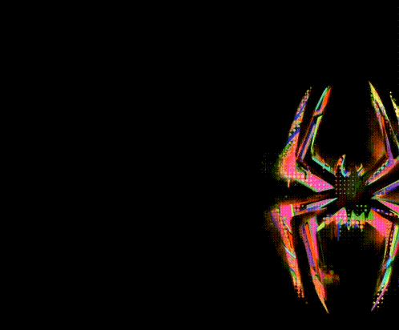
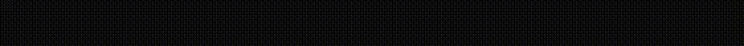

<!-- Spider-Verse Header with Overlapping Terminal -->

  <!-- Background GIF -->
  
  
  <!-- Overlapping Terminal GIF -->
  

    
  

---

## **LeetCode Stats**

---

### 🕷️ *"With great code comes great responsibility"*

